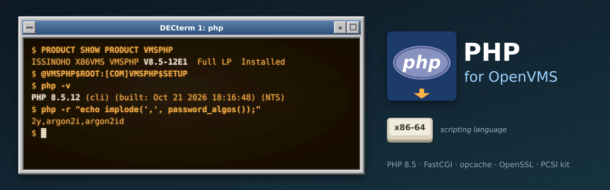

<p align="center">
  
</p>

# vms-php

A port of [PHP](https://www.php.net/) 8.5 to OpenVMS x86-64, built natively with VSI's clang
(64-bit pointers, LP64): the CLI (`PHP.EXE`) and CGI/FastCGI (`PHP_CGI.EXE`), with opcache,
mysqli for [MariaDB](https://github.com/issinoho/vms-mariadb), SQLite (`sqlite3`, `pdo_sqlite`)
from [SQLite for OpenVMS](https://github.com/issinoho/vms-sqlite), PDO, openssl through VSI's
OpenSSL 3.0 kit (SSL3), and Argon2 password hashing. It runs a live [phpBB](https://www.phpbb.com/) 3.3
board behind [lighttpd for OpenVMS](https://github.com/issinoho/vms-lighttpd), as a pool of
FastCGI processes.

> **Security:** [v8.5.12-vms1](https://github.com/issinoho/vms-php/releases/tag/v8.5.12-vms1)
> fixes **CVE-2026-109618** and **CVE-2026-109619**, two critical remote code execution bugs in
> the Zend engine ([GHSA-w8hw-w9fx-j79w](https://github.com/php/php-src/security/advisories/GHSA-w8hw-w9fx-j79w),
> [GHSA-6wmf-4rv5-p3rp](https://github.com/php/php-src/security/advisories/GHSA-6wmf-4rv5-p3rp)).
> Upgrade from 8.5.11-vms1 with `PRODUCT INSTALL VMSPHP`, then restart your FastCGI pool.

**Status:** PHP **8.5.12**. Kit **VMSPHP V8.5-12E1** (8.5.12-vms1) for x86-64; the board has
run on it since 2026-10-21. **8.5.12-vms2** (kit V8.5-12E2) adds SQLite and PDO: PHP's
sqlite3, PDO and pdo_sqlite tests (318) give the same results as on Linux, and a phpBB 3.3
board on SQLite passed the 14-point checklist and a 30-minute load run with no crash
(`docs/PHASE6.md`).
- PHP's own test suites, against a Linux build of the same release: on 8.5.11, 11,652 of 12,413
  pass on VMS, against 11,845 on Linux, and every VMS-only failure is explained
  (`docs/PHASE2.md`); on 8.5.12 the zend and fibers sets show no new VMS-only failure
  (`docs/PHASE5.md`).
- A 60-minute FastCGI soak ran with no crash and flat memory (`docs/PHASE3.md`).
- phpBB's checklist passes 14 of 14, and a load run had no crash where PHP 8.1 had four; the
  board has run on it since 2026-10-17 (`docs/PHASE4.md`).

## Installing

Requirements: OpenVMS x86-64 (built and tested on E9.2-4), VSI TCP/IP Services and VSI SSL3.

```
$ PRODUCT INSTALL VMSPHP /SOURCE=dev:[dir]
$ @VMSPHP$ROOT:[COM]VMSPHP$SETUP          ! php and php_cgi symbols
$ php -v
```

The installation defines `VMSPHP$ROOT` and `USE_ZEND_ALLOC "1"`. Add
`@SYS$STARTUP:VMSPHP$STARTUP` to `SYSTARTUP_VMS.COM`. The kit's `[VMSPHP.DOC]README.VMS` covers
running a FastCGI pool for lighttpd or Apache (`[ETC]PHP-POOL.INI-DIST`), the extensions, and
the differences from PHP on Unix.

## Running PHP behind a web server

There is no fork on OpenVMS, so the web server doesn't start PHP itself. A **pool** of
`PHP_CGI.EXE -b` processes runs beside it, each a FastCGI server on its own port, serving one
request at a time (`PHP_FCGI_CHILDREN=0`). The web server spreads `.php` requests over them.
The same pool setup serves both servers below:

- **Run the workers** as detached processes under the account that owns the application's
  writable files, with no privileges beyond `TMPMBX` and `NETMBX`. lighttpd's `PHP_POOL.COM`
  does this (`START`, `STOP`, `STATUS`), with any web server:

  ```
  $ @VMSLIGHTTPD$ROOT:[COM]PHP_POOL START 4 19000 <pool directory> VMSPHP$ROOT
  ```

- **Give the pool its own `PHP.INI`,** from `VMSPHP$ROOT:[ETC]PHP-POOL.INI-DIST`. It is
  passed with `-c` and refers to the pool directory as `/vmsphp_pool/...` (define the rooted
  logical `VMSPHP_POOL`, or edit the paths).
- **Own the writable directories.** The pool's `[.LOGS]`, `[.SESSIONS]`, `[.TMP]` and
  `[.OPCACHE]` must be owned by the pool's account. PHP checks them with `access()`, which
  ignores ACLs, and a worker that cannot use its opcache file cache exits at startup.

### lighttpd

[lighttpd for OpenVMS](https://github.com/issinoho/vms-lighttpd) vms3 or later knows this PHP.
`VMSLIGHTTPD$CONFIGURE` offers `VMSPHP$ROOT` as the PHP root. It writes the pool's `PHP.INI`
from its `PHP-VMSPHP.INI` template, creates `[PHP.OPCACHE]` and the other pool directories
owned by the service account, and starts the pool with the server:

```
$ PRODUCT INSTALL LIGHTTPD /SOURCE=dev:[dir]
$ @VMSLIGHTTPD$ROOT:[COM]VMSLIGHTTPD$CONFIGURE        ! PHP root: VMSPHP$ROOT; PHP pool: YES
$ @VMSLIGHTTPD$ROOT:[COM]VMSLIGHTTPD$CONTROL START
```

By hand, `LIGHTTPD.CONF` lists one backend per worker:

```
fastcgi.server = ( ".php" => (
    ( "host" => "127.0.0.1", "port" => 19000, "check-local" => "enable", "broken-scriptfilename" => "enable" ),
    ( "host" => "127.0.0.1", "port" => 19001, "check-local" => "enable", "broken-scriptfilename" => "enable" )
  ) )
```

To move an existing lighttpd pool from VSI's PHP 8.1:
1. In its `PHP.INI`, remove the `zend_extension = php_opcache` and `extension_dir` lines (opcache
   is built in), and add `opcache.file_cache` and
   `openssl.capath = "VMSPHP$ROOT:[ETC.CERTS]"`.
2. Create the file cache's directory, owned by the service account.
3. Set `vmslighttpd_php_root == "VMSPHP$ROOT"` in `SYS$MANAGER:VMSLIGHTTPD$CONFIG.COM`, then
   restart the service.

### Apache (VSI APACHEWS 2.4)

VSI's Apache runs its own PHP 8.1 as `mod_php`. This PHP has no Apache module, so Apache passes
`.php` to the pool with `mod_proxy_fcgi` and `mod_proxy_balancer`, which VSI ships. In
`APACHE$ROOT:[CONF]HTTPD.CONF`:

```
# LoadModule php_module modules/MOD_PHP_APACHE-2_0.EXE   <- comment out VSI's PHP,
# AddType application/x-httpd-php .php .phtml             <- and its AddType lines

LoadModule proxy_module               modules/mod_proxy.exe
LoadModule proxy_fcgi_module          modules/mod_proxy_fcgi.exe
LoadModule proxy_balancer_module      modules/mod_proxy_balancer.exe
LoadModule slotmem_shm_module         modules/mod_slotmem_shm.exe
LoadModule lbmethod_byrequests_module modules/mod_lbmethod_byrequests.exe

<Proxy "balancer://php">
    BalancerMember "fcgi://127.0.0.1:19000"
    BalancerMember "fcgi://127.0.0.1:19001"
</Proxy>
<FilesMatch "\.php$">
    SetHandler "proxy:balancer://php"
</FilesMatch>
DirectoryIndex index.php index.html
```

- **Keep VSI's `User APACHE$WWW` / `Group #-1` lines.** Without them Apache fails with
  `error creating persona for #-1`.
- **Run the pool as `APACHE$WWW`,** or give both accounts read access to the documents through
  UIC protection.
- **Not yet verified end to end:** on the test node, VSI's Apache cannot create a listening
  socket even with its own configuration. `docs/APACHE.md` has the full setup, the pool
  procedure and troubleshooting.

### Applications

- **Database host:** use `127.0.0.1` (or `localhost`, which this build also connects over TCP).
- **SQLite:** phpBB 3.3 runs on it (database type SQLite3); keep the database file outside the
  board's directory, in a directory the pool's account owns.
- **phpBB's CAPTCHA:** choose "Simple image"; the GD CAPTCHA plugins need gd, which is not
  built.
- **Passwords** hashed with argon2id by VSI's PHP 8.1 keep working.
- **`USE_ZEND_ALLOC`:** VSI's PHP 8.1 crashes with `"1"`, which this kit sets, so do not run
  both on one system.

## Notes for OpenVMS

- **No fork.** `PHP_CGI.EXE` runs as a FastCGI server (`-b`), one request at a time per
  process (`PHP_FCGI_CHILDREN=0`); the web server spreads requests over several of them.
  `proc_open()`, pcntl and `mail()` are not available: send mail over SMTP.
- **Extensions:** the phpBB set: ctype, dom, filter, json, mbstring, mysqli/mysqlnd, openssl,
  pcre (PCRE2, no JIT), session, SimpleXML, tokenizer, xml/xmlreader/xmlwriter, zlib, opcache;
  since 8.5.12-vms2 PDO with pdo_mysql and pdo_sqlite, and sqlite3. There is no gd, intl,
  iconv, curl, sockets or posix.
- **SQLite** is SQLite for OpenVMS's 3.54.1: one database can be shared by several processes
  and accounts (rollback journals; no WAL, no `loadExtension`). Each database has a
  `<database>-lock` file beside it, which stays: delete it with the database. Every account
  that writes the database needs write access to it and its directory by UIC protection
  (`is_writable()` ignores ACLs).
- **Writable directories** (opcache's file cache, sessions, uploads) must be owned by the PHP
  pool's account: PHP checks them with `access()`, which ignores ACLs.
- **`USE_ZEND_ALLOC`:** a system logical `"0"` (some older PHP installs leave one) turns PHP's
  memory manager off. The kit sets `"1"`. VSI's PHP 8.1 crashes with `"1"`, so do not run both
  on one system.
- **Database host:** `127.0.0.1` or `localhost` (both over TCP; VMS has no usable Unix-domain
  sockets).
- **Apache:** VSI's Apache can use this PHP over FastCGI (`mod_proxy_fcgi`); see
  `docs/APACHE.md`. This is not yet verified end to end.

## How this repository works

It stores only the VMS delta over the signed upstream release, the same way as its siblings
([vms-lighttpd](https://github.com/issinoho/vms-lighttpd), [vms-mariadb](https://github.com/issinoho/vms-mariadb), ...):

- `upstream.conf`: the pinned release, its SHA-256 and signing key (`keys/`), the dependencies,
  the CA bundle and Argon2
- `patches/`: 23 changes to upstream files, applied in `patches/series` order, each guarded by
  `#ifdef __VMS` and carrying its VMS reason
- `overlay/`: files we add (the build procedure, VMS helpers and shims, the kit)
- `tools/`: host-side scripts: `fetch.sh`, `prepare.sh`, `build.sh`, `kit.sh`, the `.phpt`
  runner (`phpt.sh`, `phpt.py`), staging and pool helpers, and `vms.sh` for the nodes
- `probes/`: small C and PHP programs that pin down platform behaviour
- `docs/`: the plan, the decisions (`DECISIONS.md`), the porting log (`PORTING_LOG.md`) and the
  results of each phase

Building needs the clang builds of [zlib](https://github.com/issinoho/vms-zlib),
[PCRE2](https://github.com/issinoho/vms-pcre2) and [libxml2](https://github.com/issinoho/vms-libxml2):

```sh
tools/fetch.sh && tools/prepare.sh && tools/build.sh x86 ALL && tools/kit.sh x86
```

Home page for all the ports: [openvms.issinoho.com](https://openvms.issinoho.com).
